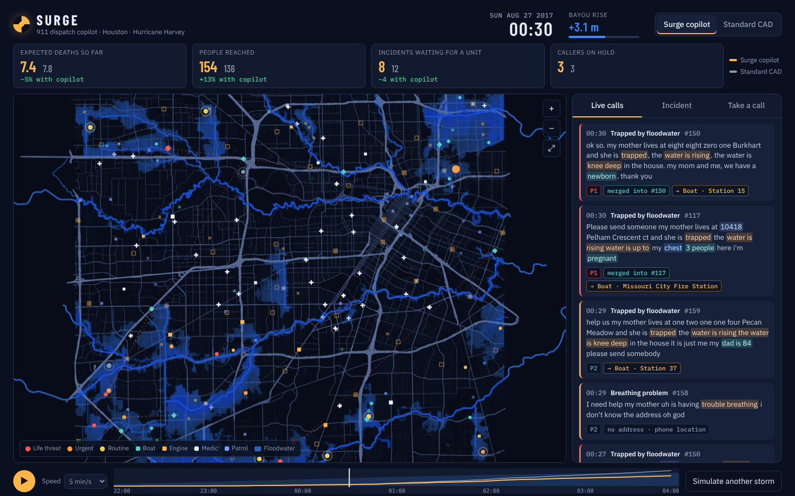
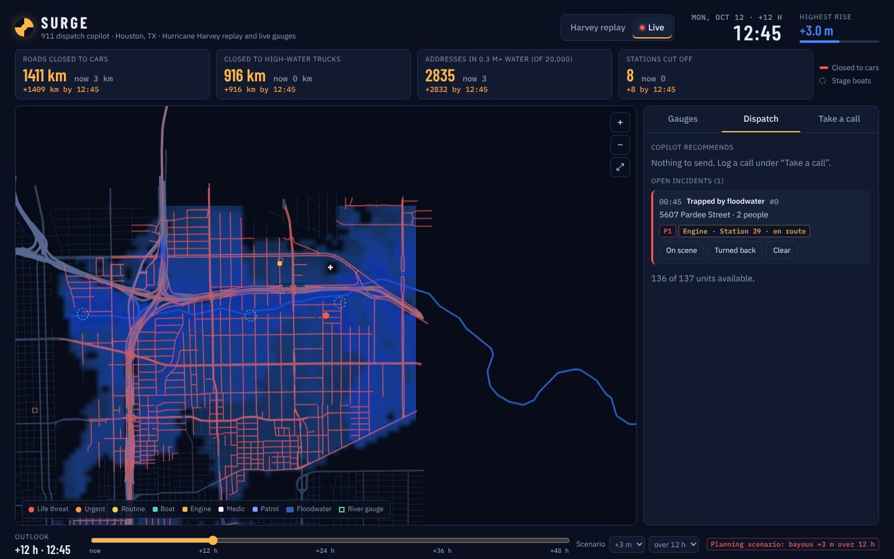

# Surge

**A 911 dispatch copilot for the night the phones never stop.**

On August 27, 2017, Hurricane Harvey put more than 56,000 calls into Houston's 911 system in 17 hours, against about 8,000 on a normal day. Callers waited on hold, hung up, and called again. Neighbors and relatives across the country called about the same family. Ambulances were sent down streets that were already under water.

Surge replays that night on the real city and asks what a dispatcher with a copilot could have done differently. It listens to each call, works out what is happening and exactly where, merges the duplicates, forecasts where the water is going from the terrain, and assigns every free crew to the incident where it saves the most lives, over roads that are actually still open.

**Result:** across 20 simulated storms it never saw during tuning, the copilot cut expected deaths by about **44%** against a standard dispatch system, and by **37%** against a standard system that is also given live flood-aware routing. Same storm, same calls, same call-takers, same 137 units.

**And it runs on today's water.** Live mode drives the same flood model from every USGS river gauge in the city and the National Weather Service's official river forecasts, shows which roads close and which streets go under over the next 48 hours, and takes real calls. `surge serve` runs it for a whole dispatch floor with a JSON API, and two commands build it for any US city from open data.

**Live demo:** [claude.ai/artifact/F27WL1pVuTzd4vZFaqWvNj](https://claude.ai/artifact/F27WL1pVuTzd4vZFaqWvNj), or open `dist/surge.html` in any browser (one self-contained file, no server). The sandboxed demo cannot reach the gauge feeds, so its Live tab runs a labeled planning scenario; `surge serve` or the file opened locally uses live gauges.



## What is real

| | Source |
|---|---|
| Road network: 104,887 road segments, bridges and underpasses | Overture Maps (OpenStreetMap), release 2026-09-23.1 |
| 43 fire stations, 21 police stations, 34 emergency departments | Overture Maps places |
| 20,000 street addresses used to geocode callers | Overture Maps addresses |
| Terrain at 75 m resolution, 0.8 to 34.6 m above sea level | AWS Terrain Tiles (USGS 3DEP / SRTM) |
| Buffalo, Brays, White Oak, Sims, Keegans and Greens bayous and their tributaries | Overture Maps water |
| 911 call volume that night | Associated Press, August 28, 2017 |

The storm timing, the individual calls and their wording are simulated. `data/fetch.sh` downloads every input straight from the public S3 buckets and `data/build.py` turns them into `data/houston.json`.

## How it works

```
 caller's words ──▶ HEAR ──▶ MERGE ──▶ FORECAST ──▶ ASSIGN ──▶ unit on the flooded road network
                    triage    dedup     terrain      optimal
                                        flood model  assignment
```

**Hear** (`src/triage.ts`). A transcript becomes a structured incident in about 0.1 ms with no network and no model download: incident type from a weighted phrase lexicon with negation handling ("he is *not* bleeding"), the street address resolved against real address points (house numbers spoken digit by digit, abbreviations, one-letter typos, range interpolation for numbers it has never seen), head count, vulnerability (infants, elderly, wheelchair users, oxygen and dialysis patients), reported water depth, and whether this is a repeat caller. Street names are removed before classification so "Hazard Street" cannot vote for an emergency. Every conclusion carries the words that produced it, which the console highlights. On thousands of simulated calls it gets the type right 99.4% of the time; on a set of hand-written calls it never saw during development it gets all of them (`test/core.test.ts`).

**Merge** (`src/dispatch.ts`). Repeat callers (same phone number), neighbors (same address) and callers with no address inside the same phone location fix become one incident. Each repeat call updates it with the worst news: the water is at our chest now.

**Forecast** (`src/flood.ts`). A priority flood seeded at every bayou cell computes, for each 75 m terrain cell, the channel it drains to and the lowest water level that can reach it over the ridges in between. That is the HAND idea (height above nearest drainage, used by NOAA's National Water Model for inundation maps) with spill barriers, so a neighborhood behind a ridge stays dry until the water overtops it and then fills at once. From one stage curve it predicts when each address goes waist-deep and chest-deep, and when each road segment closes to cars (0.3 m), high-water engines (0.9 m) and boats (never). Bridges stay open; underpasses close first.

**Assign** (`src/dispatch.ts`, `src/hungarian.ts`). Every few minutes, the copilot builds a matrix of free units against waiting incidents. Each entry is the expected number of lives saved by sending that unit now rather than in two hours, from a risk model per incident type (cardiac arrest decays in minutes; rising water is harmless until it is suddenly not, and the forecast says when), minus the opportunity cost of the crew's drive time on the flooded network. The Kuhn-Munkres algorithm picks the optimal assignment. Dijkstra on a 41,000-node graph takes about 2 ms.

**Simulate** (`src/sim.ts`, `src/scenario.ts`). A discrete-time model of one 911 center: calls ring, wait on hold, hang up and redial, get answered by eight call-takers, and enter the dispatch queue. Units drive the real roads; medics transport to the nearest reachable emergency department. Ground truth decides who survives. A caller who has been rescued stops calling, so a slow dispatcher really does get more repeat calls.

## Live mode

The replay proves the strategy on a night that already happened. Live mode is the same engine pointed at now.


*The live console 12 hours ahead: red roads are closed to cars, dashed rings are where to stage boats, and the copilot's boat is already on its way to a logged call. This screenshot runs the +3 m planning scenario because the machine that took it cannot reach the gauge feeds.*

**Gauges** (`src/live/gauges.ts`). Every active USGS stream gauge in the city's box (gage height, updated every 5 to 15 minutes) and every NWS river forecast point, joined on the USGS site id. NOAA's official stage forecast extends each gauge's record two to five days ahead; where NOAA issues none, the gauge holds its latest reading rather than inventing a trend. Stage is measured above each gauge's base flow, which is the level the terrain model's channel cells sit at.

**One bayou at a time.** Each gauge snaps to the mapped channel it sits on, and its reading spreads along the connected stream network, so every reach follows the nearest gauge on its own stream instead of the nearest gauge on a neighboring one. Brays Bayou can be in flood while Buffalo Bayou is not, and the map and the roads show it (`test/live.test.ts`).

**Outlook.** Slide up to 48 hours ahead: kilometers of road closed to cars and to high-water trucks, address points in car-stalling water, fire and police stations whose own streets are cut, and the streets where water reaches chest height first, which is where to stage boats before the calls come. A what-if control raises every gauge by up to 3 m.

**Dispatch** (`src/live/center.ts`). Calls are typed in or posted by any system that can send text (a call-taker's screen, a speech-to-text feed, an existing CAD). They are triaged, merged with repeat callers, and the copilot recommends the optimal assignment of free units over the roads as the gauges say they are. Nothing moves until a dispatcher presses Dispatch; crews report on scene, clear, or turned back by water, and a turned-back vehicle type is never recommended for that incident again.

```bash
node dist/cli.js live --hours 6                  # gauges, forecasts and the outlook for the city, in the terminal
node dist/cli.js live --save snapshot.json       # keep today's readings to rehearse with later
node dist/cli.js serve --port 8080               # the console at http://localhost:8080, gauges refreshed every 10 minutes
node dist/cli.js serve --gauges snapshot.json    # rehearse on a saved snapshot, offline
```

| API | |
|---|---|
| `GET /api/status` | data source, gauges with NOAA forecasts and flood categories, model coverage |
| `GET /api/gauges` | the raw readings and forecasts the model runs on |
| `GET /api/readiness?hours=6` | roads closed, addresses under water, stations cut off, streets to stage boats on |
| `GET /api/board` | units and incidents |
| `GET /api/recommendations` | the copilot's assignments right now, with routes |
| `POST /api/calls` | `{text, phone?, lat?, lon?, accuracy?}` returns the triaged incident, merged or new |
| `POST /api/dispatch` | `{unit, incident}` |
| `POST /api/units/:id` | `{status: on_scene \| available \| out_of_service \| turned_back}` |
| `POST /api/scenario` | `{offset}` raises every gauge, `{rise, hours}` plans with no live data |

### Any city

```bash
bash data/fetch.sh -97.80,30.22,-97.68,30.33 raw-austin       # Overture Maps + terrain tiles for any US box
python3 data/build.py --name "Austin, TX (central)" --bbox=-97.80,30.22,-97.68,30.33 --raw data/raw-austin --out data/austin.json
node scripts/build.mjs --city data/austin.json                  # dist/surge-austin.html, a live-only console
node dist/cli.js serve --city data/austin.json
```

The download takes about a minute and the build four seconds. `data/austin.json` is included: 14,510 road nodes, 18 fire stations, 20,000 addresses, Shoal, Waller and Boggy creeks and the Colorado River. Rebuilding Houston with the generic pipeline reproduces `data/houston.json` byte for byte.

## Benchmark

`npm run bench -- --seeds 20` runs every dispatcher on the same 20 storms (seeds 101 to 120, none used for tuning):

| Dispatcher | Expected deaths | Incidents reached | Life-threat median (min) | Life-threat p90 (min) | Never reached | Turned back by water | Repeat calls | Hung up on hold |
|---|---:|---:|---:|---:|---:|---:|---:|---:|
| First come, first served | 104.8 ± 7.0 | 260 | 22.3 | 128.6 | 106.1 | 294 | 582 | 679 |
| Standard CAD | 100.2 ± 7.0 | 260 | 23.3 | 122.9 | 99.8 | 297 | 555 | 615 |
| CAD + flood routing | 88.0 ± 7.5 | 279 | 22.8 | 111.5 | 91.2 | 2 | 472 | 477 |
| Surge, no flood forecast | 65.8 ± 4.5 | 315 | 37.6 | 115.3 | 66.7 | 3 | 518 | 428 |
| **Surge copilot** | 55.7 ± 4.4 | 322 | 24.1 | 74.5 | 56.0 | 3 | 361 | 182 |

- **First come, first served** sends the closest free unit to each call in the order calls were answered.
- **Standard CAD** is what a modern computer-aided dispatch system does: protocol priority, closest unit by straight-line distance, duplicates merged on matching address or phone number. Its call-takers code every call correctly and always get the address right when the caller says it, which is generous.
- **CAD + flood routing** is the same, but picks units by drive time on the flooded network, so it knows which units can actually get there.
- **Surge, no flood forecast** is the copilot with the terrain model switched off, to show what the forecast is worth on its own.

Life-threat response time is from the first call to a unit arriving for trapped people, vehicles in water, cardiac arrests, fires and breathing emergencies. The copilot's median response is about the same as the baselines; the gain is in the long tail (p90 drops from 123 to 75 minutes) because it reaches the people whose water is rising fastest first. It also takes far fewer repeat calls and hang-ups, because people it has already rescued stop calling.

## Run it

```bash
npm install
npm test                 # 33 tests: assignment vs brute force, flood physics, routing, triage on unseen calls, simulation, gauge feeds, live dispatch
npm run build            # dist/cli.js and dist/surge.html (precomputes the opening storm)
node dist/cli.js triage "we're in the attic with my mom she's 79, water is almost to the ceiling, 5607 pardee street"
node dist/cli.js calls --seed 3 --n 10
npm run bench -- --seeds 20
```

To rebuild Houston from scratch (needs Python with pyarrow, shapely, numpy, pillow): `bash data/fetch.sh && npm run data`.

## Limitations

- The risk model is deliberately simple, and the copilot plans with the same model that scores outcomes. Read the benchmark as a comparison of dispatch strategies under a shared model of harm, not as a forecast of deaths.
- The replay drives every bayou with one scenario stage curve (tributaries rise half as much). Live mode uses one curve per gauge, but tributaries without their own gauge still follow their bayou's at half the rise, and rain ponding away from channels is not modeled.
- The terrain model has no levees, flood walls or dams. In a city protected by levees, or on a dam-controlled river, it will over-predict flooding from that channel.
- Base flow is taken from the lowest reading in the past week. If a city has been in flood all week, live depths are underestimated.
- Roads are two-way, and traffic is a single storm slowdown factor.
- The triage lexicon is English-only and was developed against generated calls plus a hand-written test set. A production system would put a speech model and an LLM extractor in front of it, keeping this deterministic layer as the explainable fallback.
- This is a research prototype, not a medical or emergency tool.

## License

MIT. Map data © OpenStreetMap contributors (ODbL) via Overture Maps Foundation.
